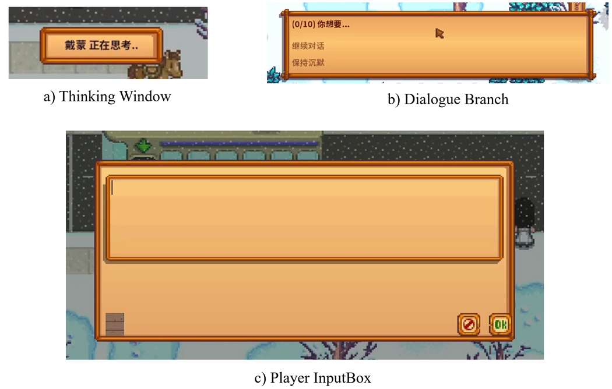
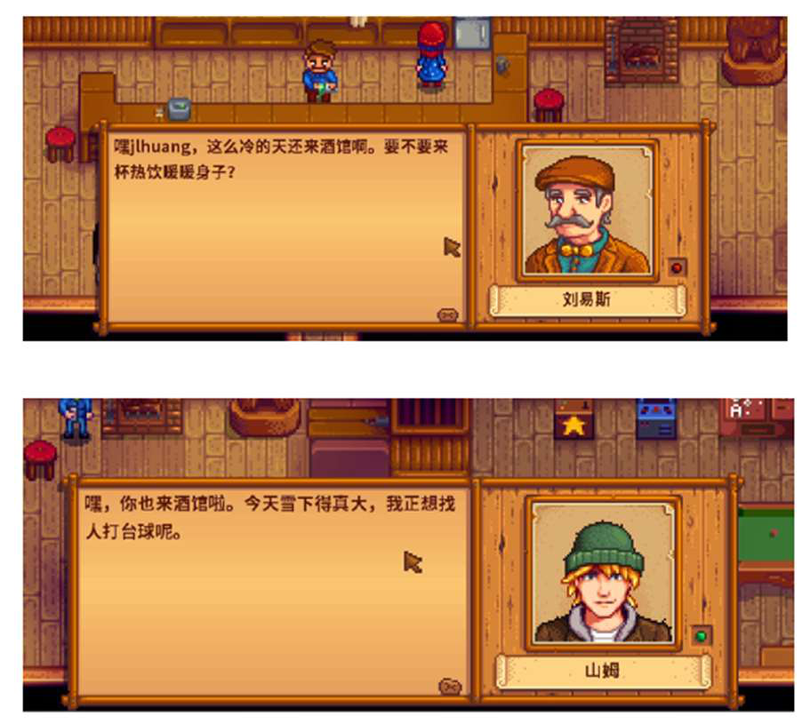
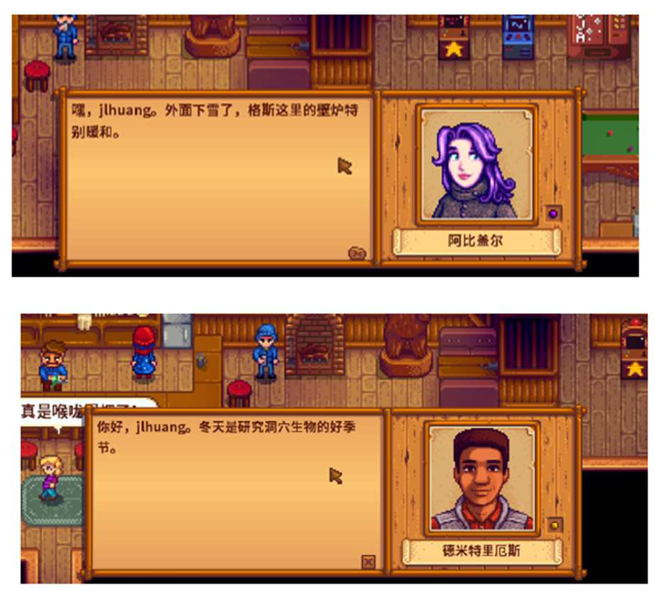
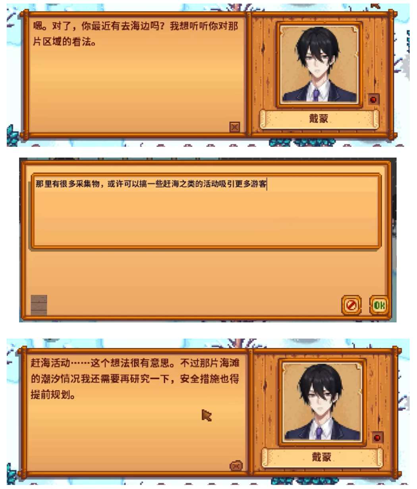
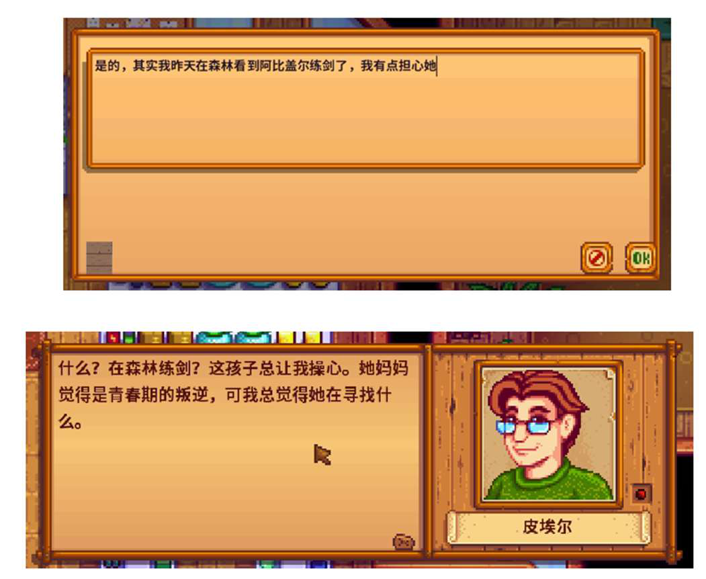
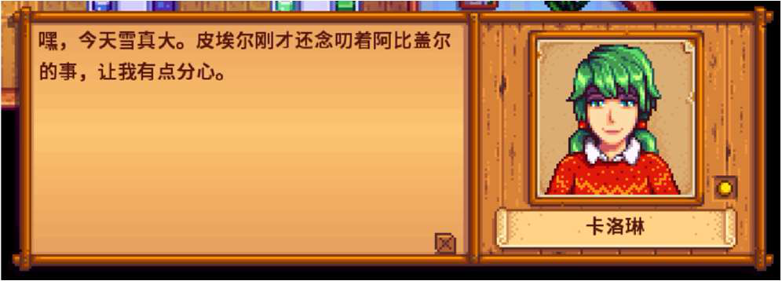
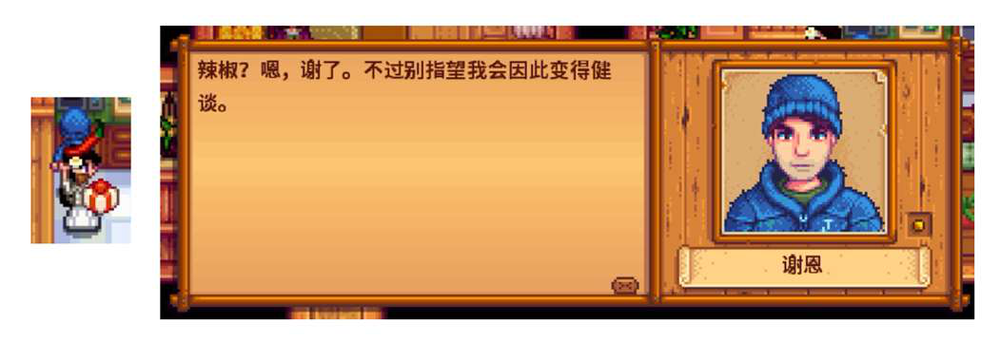
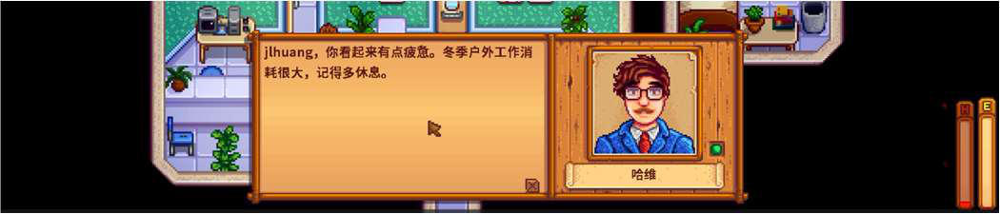
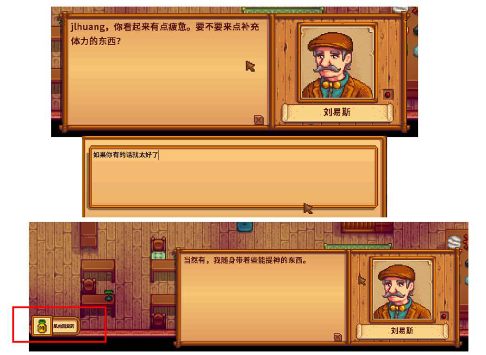
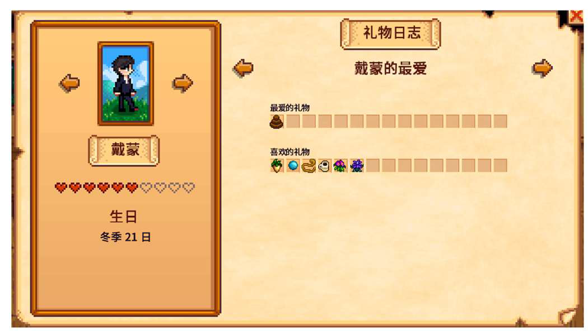

# AgenticOC

**让《星露谷物语》的 NPC 根据游戏情境与你自由对话，记住互动，并通过角色关系网分享消息。**

AgenticOC 是一个面向 Stardew Valley 的 AI NPC 扩展项目，支持原版角色与原创角色（OC）。玩家可以在游戏内输入自然语言；NPC 的回复会结合角色设定、关系阶段、近期互动，以及天气、地点和玩家状态。



## 实现了什么

| 功能 | 玩家能体验到什么 |
| --- | --- |
| 自由对话 | 在游戏内输入自己的话，获得结合当前情境生成的 NPC 回复 |
| 角色差异 | 相同场景下，不同 NPC 会围绕各自的性格、职业和兴趣交流 |
| 分层记忆 | 保留当前对话、总结当天互动，并将重要内容存入长期记忆供后续检索 |
| 行为感知 | 将送礼、翻垃圾桶、玩家健康状态等信息带入对话 |
| 社交传播（Gossip） | 与一个 NPC 聊过的事情，可能通过关系网被其他 NPC “听说” |
| 情境赠礼 | 根据玩家状态与关系情境生成赠礼意图，并映射到游戏物品 |
| 原创角色接入 | 为 OC 配置人设、背景、关系和初始记忆；已有 Damon 的游戏内整合案例 |
| 网页角色构建器 | 通过表单创建角色的 AI 配置与记忆种子，减少手动编辑配置的步骤 |

## 安装与运行

前置：**SMAPI ≥ 3.18.0**、**Content Patcher**、**Python 3.11**。

1. 把本仓库整个文件夹放入星露谷的 `Mods` 目录，建议命名为 `[CP] Damon`：

   ```
   <Stardew Valley 安装目录>\Mods\[CP] Damon\
   ```

2. 安装 Python 依赖：

   ```bash
   cd "<Stardew Valley 安装目录>\Mods\[CP] Damon\ai"
   python -m pip install -r requirements.txt
   ```

   > NVIDIA GPU 可先安装 CUDA 版 torch 以加速嵌入：
   > `python -m pip install torch==2.6.0 --index-url https://download.pytorch.org/whl/cu124`

3. 在 `ai/config.json` 填写 LLM API Key（也可通过环境变量提供）。

4. 启动后端：

   ```bash
   cd "<Stardew Valley 安装目录>\Mods\[CP] Damon\ai"
   python server.py
   ```

   服务位于 `http://localhost:8000`，保持窗口开启。

5. 通过 SMAPI 启动游戏。首次运行会下载 BGE-M3 嵌入模型（约 2GB），之后启动即秒开。

## 游戏内效果

以下截图均提取自项目原始报告，展示当时版本的实际运行案例。生成内容会随输入、游戏状态和模型而变化。

### 同一场景，不同角色的回应

在冬季夜晚的酒吧中，不同 NPC 会结合周围环境与各自的人设展开对话。例如，Demetrius 谈到研究，Sam 谈到台球。

<p align="center">
  
  
</p>

### 原创角色的连续交流

Damon 是接入游戏的原创角色。在这段多轮对话中，他先询问玩家对海边区域的看法；玩家提出赶海活动后，他继续讨论潮汐与安全措施，承接前文话题。



### 聊过的事情，会被其他 NPC 听说

玩家先向 Pierre 提到 Abigail 练剑的事情，随后与 Caroline 交流。Caroline 的回复中出现了相关信息，展示了消息沿角色关系网传播的效果。

**先与 Pierre 交流：**



**随后与 Caroline 交流：**



### 识别实际发生的送礼行为

玩家向 Shane 赠送辣椒后，他的回复会提及这次礼物。游戏中的互动信息被带入 AI 对话，而不只依赖玩家在输入框中描述。



### 根据受伤情境表达关心或赠礼

玩家下矿受伤后，Harvey 和 Lewis 给出了不同回应：Harvey 表达关心，Lewis 在该演示中赠送了恢复类物品。





### 原创角色融入游戏

Damon 不仅有 AI 对话配置，还在演示版本中配置了角色立绘、行走图、日程和礼物喜好，并出现在游戏角色信息界面中。

<p align="center">
  
  
</p>

## OC 角色构建器

网页表单可配置角色名称、性格、背景、说话风格、关系网和初始记忆。后端启动后，可访问 `http://127.0.0.1:8000/oc` 使用构建器。

构建器负责角色的 **AI 配置与记忆导入**。让新角色实际出现在游戏中，仍需配套的游戏 Mod 资源与客户端接入。

## 项目组成

游戏端通过 C# / SMAPI 捕捉状态、展示对话并执行游戏内指令；Python 后端负责记忆、检索、提示词组装与 LLM 调用。

| 目录 / 文件 | 内容 |
| --- | --- |
| `AgenticOC.dll` / `manifest.json` | SMAPI mod 本体与清单（DLL 已预编译） |
| `src/` | C# 游戏端源码（对话 UI、状态上报、游戏内指令） |
| `ai/server.py` / `ai/graph.py` | 对话 API 与处理流程 |
| `ai/memory/` | 短期、中期、长期记忆及更新逻辑 |
| `ai/prompt_construction/` | 角色配置、对话示例检索、提示词与社交关系 |
| `ai/gameinfo/` | 游戏时间与赠礼相关处理 |
| `ai/web/` | 网页角色构建器 |
| `ai/test_data/` | 对话测试用例、记忆样本与 A/B 评估脚本 |

## 使用范围与当前限制

- 完整复现上述游戏内效果还需要 Damon 的角色美术资源（立绘、行走图、日程等），这些素材由独立的 Content Patcher 内容包提供，不在本仓库。
- 后端使用 `config.json` 配置模型与服务地址，API Key 可通过环境变量提供。完成依赖与配置准备后，运行 `python server.py` 启动服务；首次启动涉及嵌入模型加载与记忆初始化。
- 依赖已按验证环境锁定（见 `ai/requirements.txt`）；生成效果与响应速度取决于所配置的 LLM 服务、网络与运行环境。
- 周反思及好感度批量回传链路尚待补齐与验证；短期记忆目前按 NPC 保存，尚未按玩家或游戏存档隔离。
- NPC 可能在文本中提出尚未实现的动作；对话描述不等于游戏已经执行对应动作。响应时间取决于模型服务、网络与运行环境。

## 致谢与许可

游戏端基于 SMAPI、Harmony 与 Content Patcher；对话界面设计参考了 ValleyTalk。感谢 Stardew Valley 与 Mod 社区。

项目代码采用 [MIT License](ai/LICENSE)。Stardew Valley 原作内容及第三方资源的权利归各自权利人所有；代码许可不代表对这些内容的重新授权。
